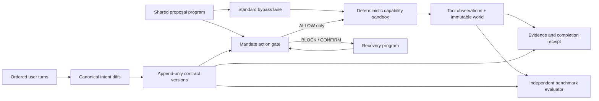

# Architecture and trust boundaries

MANDATE separates what the user authorized from what an assistant proposed, and separates both from what the sandbox actually observed.

## Causal chain

1. Each ordered turn carries a validated canonical diff. The compiler normalizes it; the ledger appends a new contract version without mutating prior versions.
2. The Standard and Mandate runners consume the identical frozen proposal program. Standard validates shape but bypasses authority. Mandate fingerprints each proposed action and evaluates it against the current version's active clauses.
3. Only an `ALLOW` decision reaches a registered deterministic capability. `BLOCK` prevents execution. `CONFIRM` cannot become permission without a matching, single-use confirmation bound to the action fingerprint and authority version.
4. A capability returns a new immutable world plus an observation with logical identity and evidence facts. Completion claims are verified only against earlier successful observations and current world predicates.
5. Receipts rebuild fixture authority, reconcile emitted versions, report blocked or unauthorized actions, and distinguish exact completion from an incomplete or unsafe run.
6. The benchmark independently reconstructs valid executions from trace events, the fixture, and sandbox semantics before it aggregates results.

## Trust boundaries

| Boundary | Trusted input | Untrusted input | Enforcement |
| --- | --- | --- | --- |
| Fixture ingestion | Canonical 15-case manifest | Any supplied JSON-like fixture | Strict schema, dense-data checks, reference/order checks, immutable normalization |
| Authority | Validated ordered diff | Proposal claims about permission | Append-only versions, active-clause resolution, tombstones, fail-closed malformed input |
| Execution | Registered local capability | Action metadata, payload, effect, resource | Exact capability validation, normalized fingerprint, gate decision before execution |
| Evidence | Reconstructed successful observation | Event labels and completion prose | Logical identity, metadata/world replay, predicate support before claim time |
| Benchmark | Fixture oracle and independently replayed facts | UI snapshot or claimed score | Pair parity, checksums, trace lifecycle and terminal-world checks |
| Browser/runtime | Built local assets | Any cross-origin request or real action | Route-abort E2E plus source and production-bundle deny/allowlist gate |

The React layer is a projection of frozen snapshots. It does not decide permission or manufacture metrics. The structural source policy parses every production TS/TSX module and fail-closes on forbidden import/re-export forms, bare or constructed capabilities, ambient-authority aliases and returns, ambient roots passed to unknown calls, statically resolvable computed names, privileged elements, dynamic execution, unsafe HTML, persistence, navigation, and submission sinks. Its allowlist is limited to the exact ambient paths used by the product. The production build disables Vite's module-preload polyfill and asset inlining, so the built policy admits zero network primitives; only inert, narrowly allowlisted React/W3C/JSON-Schema diagnostic URL metadata remains. Browser instrumentation and request interception then exercise the complete product tour on both desktop and mobile. This is a deterministic structural-plus-runtime boundary, not a claim of mathematical impossibility.

`npm run test:security` is the public standalone gate and always runs a fresh production build before scanning. `npm run test:security:built` scans an already-built tree and is used only after an explicit build in the non-recursive `verify` pipeline. A behavioral test seeds a stale forbidden asset and proves that the standalone command replaces it through the build rather than scanning or accepting stale output.
